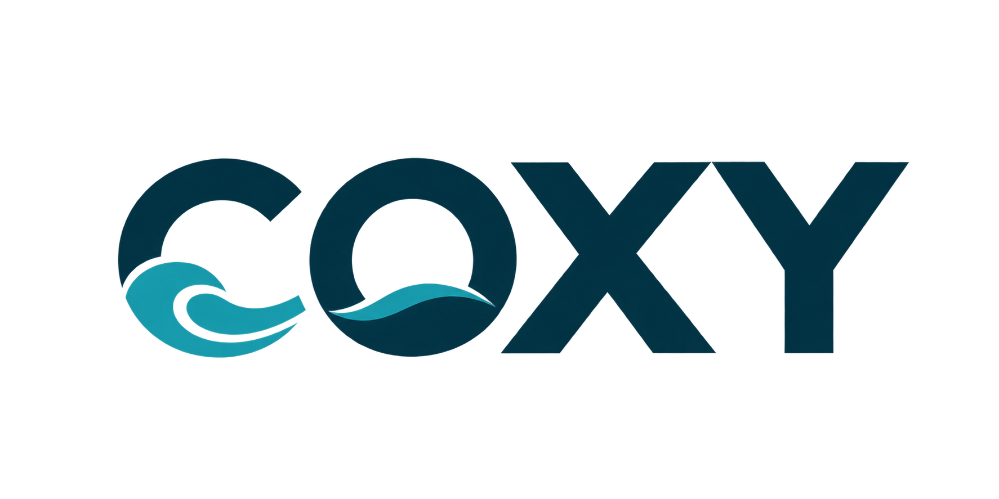

<p align="center">
  
</p>

<h1 align="center">COXY — Discover the Beauty of Cox's Bazar</h1>

<p align="center">
  <strong>An interactive, cinematic scrollytelling web experience celebrating the world's longest natural sea beach in Bangladesh.</strong>
</p>

<p align="center">
  <a href="#-features">Features</a> •
  <a href="#-tech-stack">Tech Stack</a> •
  <a href="#-quick-start">Quick Start</a> •
  <a href="#-architecture">Architecture</a> •
  <a href="#-destinations">Destinations</a> •
  <a href="#-author">Author</a>
</p>

<p align="center">
  
  
  
  
  
</p>

---

## 🌊 Overview

**COXY** is a bespoke coastal discovery platform dedicated to the breathtaking geography of **Cox's Bazar, Bangladesh**—home to an unbroken 120 km stretch of golden sand touching the warm currents of the Bay of Bengal.

Built with high-performance scrollytelling engineering, the website integrates an **840-frame cinematic sequence** directly into the hero experience: starting with 600 frames of a 3D aerial map fly-through across the coastline and hills, smoothly dissolving into 240 frames of a tranquil beach sunset stroll. As visitors scroll, GPU-accelerated canvas scrubbing brings the journey to life in real-time, accompanied by liquid glassmorphic navigation and an editorial travel journal.

---

## ✨ Features

- 🎞️ **Cinematic Dual-Phase Scroll Animation**: Seamlessly scrub through 840 high-definition frames (600 aerial drone map frames followed by 240 golden hour beach stroll frames with a crossfade dissolve transition) with buttery-smooth linear interpolation (LERP) physics.
- ⚡ **Zero-Lag Preloader**: Pre-buffers frame sequences into memory with an animated percentage counter and progress bar, ensuring hitch-free 60 FPS playback.
- 🧊 **Adaptive Glassmorphism Navbar**: Full-bleed blur header that dynamically adapts between a sheer coastal midnight glass state (with crisp white branding) and an editorial sand state on scroll.
- 🏖️ **Editorial Destination Guide**: Rich travel showcases for Cox's Bazar Sea Beach, Himchari National Park, Inani Coral Beach, Maheshkhali Island, Sonadia Island, and Kolatoli Point.
- 📱 **Fully Responsive Layout**: Designed across 12-column editorial fluid grids with bespoke breakpoints for ultra-wide displays, laptops, tablets, and smartphones.
- 🧭 **Interactive Floating Milestone HUD**: Dynamic narrative captions appear smoothly at key chronological milestones throughout both the aerial coastline fly-through and the beach walk.
- 💌 **Integrated Contact Dispatch**: Interactive topic-based inquiry form with validation and instant feedback.

---

## 🛠️ Tech Stack

| Layer | Technology | Purpose |
| :--- | :--- | :--- |
| **Structure** | HTML5 Semantic Elements | Accessible, SEO-optimized markup hierarchy |
| **Styling** | Vanilla CSS + Tailwind CSS | Custom design tokens, glassmorphism, responsive utilities |
| **Typography** | Google Fonts (`Outfit` & `Plus Jakarta Sans`) | Editorial display headings and fluid body reading |
| **Rendering** | HTML5 2D Canvas API | High-DPI retina rendering & aspect-ratio cover math |
| **Motion Physics** | LERP & `requestAnimationFrame` | Jitter-free frame scrubbing and momentum smoothing |
| **Icons** | Material Symbols Outlined & Vector SVGs | Crisp scalable UI iconography |

---

## 🚀 Quick Start

### 1. Clone the Repository
```bash
git clone https://github.com/mfbhai10/COXY.git
cd COXY
```

### 2. Launch Local Server
You can run the site using any static server:

#### Option A: Python (Built-in)
```bash
python3 -m http.server 3000
```

#### Option B: Node.js (npx serve)
```bash
npx serve -l 3000 .
```

### 3. Open in Browser
Visit **[http://localhost:3000](http://localhost:3000)** to experience the animation.

---

## 📐 Architecture & Key Concepts

### 1. High-Performance Canvas Scrubbing
Instead of heavy video tags that suffer from scrubbing delay, **COXY** utilizes an HTML5 `<canvas>` pinned inside a tall scroll track (`hero-scroll-track`).

```javascript
// Linear interpolation for silky-smooth scrub momentum
const diff = targetFrameIndex - currentFrameIndex;
if (Math.abs(diff) > 0.001) {
  currentFrameIndex += diff * 0.16;
} else {
  currentFrameIndex = targetFrameIndex;
}
```

### 2. Aspect-Ratio Cover Scaling Math
Every frame is dynamically sized to fill the viewport without distortion or letterboxing across any device ratio:
```javascript
const imgRatio = img.naturalWidth / img.naturalHeight;
const screenRatio = canvasWidth / canvasHeight;

if (screenRatio > imgRatio) {
  drawWidth = canvasWidth;
  drawHeight = canvasWidth / imgRatio;
  offsetY = (canvasHeight - drawHeight) / 2;
} else {
  drawHeight = canvasHeight;
  drawWidth = canvasHeight * imgRatio;
  offsetX = (canvasWidth - drawWidth) / 2;
}
```

### 3. Smart Asset Switching
The navbar automatically alternates between **`assets/logo-white.png`** (white typography with teal waves over the dark beach hero) and **`assets/logo.png`** (deep ocean navy with teal waves over light content sections) using CSS transition rules.

---

## 📂 Project Structure

```text
COXY/
├── assets/
│   ├── logo.png             # Official brand logo (Deep navy letters + cyan wave)
│   └── logo-white.png       # Hero brand logo (Pure white letters + cyan wave)
├── frames/
│   ├── aerial/              # 600 sequential aerial 3D map frames (0001 to 0600)
│   └── beach/               # 240 sequential golden hour beach stroll frames (001 to 240)
├── app.js                   # Canvas renderer, LERP loop, scroll tracker, dual-sequence transition
├── index.html               # Main application document & design system config
├── style.css                # Glassmorphism, preloader, cinematic vignettes & overrides
└── README.md                # Project documentation
```

---

## 📍 Featured Destinations

| Destination | Elevation / Type | Signature Highlights |
| :--- | :--- | :--- |
| **Cox's Bazar Sea Beach** | 120 km Shoreline | Longest natural sandy beach, crashing tidal rollers, golden sunsets |
| **Himchari National Park** | Coastal Hills | Tropical waterfalls, cliffside Marine Drive panoramas, coastal forestry |
| **Inani Beach** | Coral Coast | Natural coral boulders, crystal-clear shallow surf, tranquil waters |
| **Maheshkhali Island** | Island Heritage | Mangrove waterways, historic Adinath Hill Temple, traditional salt pans |
| **Sonadia Island** | Eco-Sanctuary | Undisturbed barrier sand dunes, red crab colonies, migratory waterfowl |
| **Kolatoli Point** | Maritime Horizon | Traditional crescent moon *Sampan* wooden fishing boats in amber mist |

---

## 📄 License

This project is created for editorial and showcase purposes celebrating the natural coastline of Bangladesh.  
All photography and frame sequences remain the property of their respective creators.

---

<p align="center">
  Made with ❤️ for <strong>Cox's Bazar, Bangladesh</strong> • <code>21°26' N 91°59' E</code>
</p>
